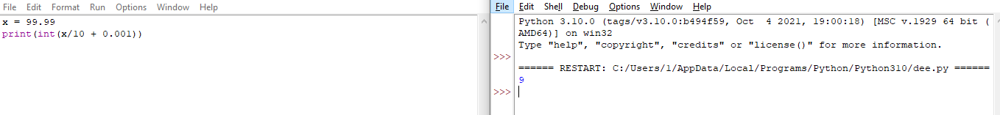
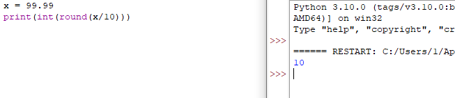
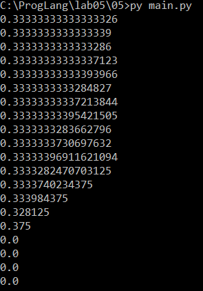
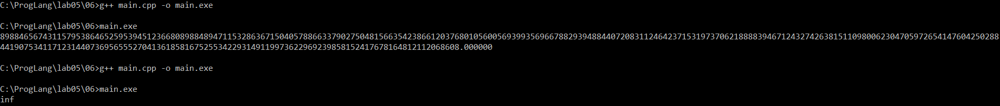
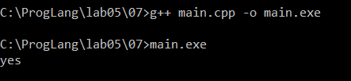
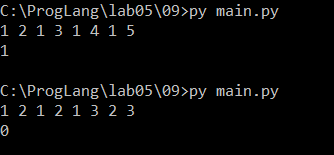

# Языки программирования

## Лабораторная работа № 5. Вещественные числа

## Практикум по Python

### 1.

```python
n = int(input())
print(n - (n % 15), n % 15)
```

### 2.

```python
n = input()

mid = len(n) // 2

first = int(n[:mid])
second = int(n[mid:])

print(first + second)
```

### 3.

```python
n = int(input())

print(f"{n / 3:.3f}")
```

### 4.

```python
price = float(input())

rubles = int(price)
kopecks = round((price - rubles) * 100)

print(rubles, "руб.", kopecks, "коп.")
```

### 5.

```python
n, m, c, k = map(int, input().split())

paper = n * m - k

if paper <= 0:
    print(0)
else:
    packs = (paper + 199) // 200
    print(packs * c)
```

### 6.

```python
n, m, k = map(int, input().split())

candies = n * m
boxes = (candies + k - 1) // k

print(boxes)
```

### 7.

```python
import math

n, t = map(float, input().split())

pulse = n * 60 / t

print(math.ceil(pulse))
```

### 8.

```python
import math

x, y = map(float, input().split())

first = math.ceil(x)
last = math.floor(y)

print(max(0, last - first + 1))
```

### 9.

```python
s = input()

summa = 0

for i in s:
    if i.isdigit():
        summa += int(i)

print(summa)
```

### 10.

```python
s = input()

result = ""

for i in s[::-1]:
    if i == "(":
        result += ")"
    else:
        result += "("

print(result)
```

### 11.

```python
s = input().split()

for word in s:
    print(word[::-1], end=" ")
```

### 12.

```python
numbers = list(map(int, input().split()))

for n in numbers:
    for d in range(2, n + 1):
        if n % d == 0:
            print(d, end=" ")
            break
```

### 13.

```python
n = int(input())

summa = 0

for i in range(1, n):
    if n % i == 0:
        summa += i

print(summa)
```

### 14.

```python
n = int(input())

masha = 0
dasha = 0

for i in range(n):
    number = int(input())

    if number % 3 == 0:
        masha += 2
    else:
        dasha += 1

print(masha, dasha, sep=":")
```

### 15.

```python
n = int(input())

profit = 0

for i in range(n):
    price, cost = map(int, input().split())

    if price > cost:
        profit += price - cost

print(profit)
```

---

## Задание 1

> Переведите в двоичную запись два произвольных рациональных числа. У одного числа знаменатель должен быть равен 32, а у другого должен находиться в диапазоне от 9 до 12. Запись второго числа должна содержать период. Процесс решения необходимо представить в отчёте без использования вычислительной техники.

### Первое число

Возьмём число:

```text
13/32
```

Так как `32 = 2^5`, дробь можно сразу представить как сумму отрицательных степеней двойки:

```text
13 = 8 + 4 + 1
13/32 = 8/32 + 4/32 + 1/32
13/32 = 1/4 + 1/8 + 1/32
13/32 = 2^-2 + 2^-3 + 2^-5
```

Следовательно:

```text
13/32 = 0.01101₂
```

Проверка:

```text
0.01101₂ = 0·2^-1 + 1·2^-2 + 1·2^-3 + 0·2^-4 + 1·2^-5
0.01101₂ = 1/4 + 1/8 + 1/32 = 13/32
```

### Второе число

Возьмём число:

```text
5/12
```

Для перевода дробной части последовательно умножаем остаток на два. Целая часть результата становится очередной двоичной цифрой.

```text
5/12 · 2 = 10/12 = 0 + 10/12   → 0
10/12 · 2 = 20/12 = 1 + 8/12  → 1
8/12 · 2 = 16/12 = 1 + 4/12   → 1
4/12 · 2 = 8/12 = 0 + 8/12    → 0
```

Остаток `8/12` уже встречался. Поэтому цифры `10` будут повторяться:

```text
5/12 = 0.0110101010...₂
5/12 = 0.01(10)₂
```

В скобках записан период дроби.

---

## Задание 2

> Переведите в двоичную запись и найдите машинное представление в типе `double` для произвольного вещественного числа больше 100 с одним знаком после точки. Цифра после точки не должна быть нулём или пятёркой. Процесс решения необходимо представить в отчёте без использования вычислительной техники.

Возьмём число:

```text
113.7
```

### Перевод целой части

Разложим `113` по степеням двойки:

```text
113 = 64 + 32 + 16 + 1
113 = 2^6 + 2^5 + 2^4 + 2^0
```

Поэтому:

```text
113₁₀ = 1110001₂
```

### Перевод дробной части

Для числа `0.7` последовательно умножаем дробную часть на два:

```text
0.7 · 2 = 1.4 → 1, остаток 0.4
0.4 · 2 = 0.8 → 0, остаток 0.8
0.8 · 2 = 1.6 → 1, остаток 0.6
0.6 · 2 = 1.2 → 1, остаток 0.2
0.2 · 2 = 0.4 → 0, остаток 0.4
```

Остаток `0.4` повторился, поэтому появилась периодическая последовательность `0110`:

```text
0.7₁₀ = 0.1(0110)₂
```

Полная двоичная запись числа:

```text
113.7₁₀ = 1110001.101100110011...₂
```

### Нормализация

Перенесём точку на шесть разрядов влево:

```text
1110001.101100110011...₂ = 1.110001101100110011...₂ · 2^6
```

### Формирование `double`

Тип `double` стандарта IEEE 754 содержит:

- один бит знака;
- 11 бит порядка;
- 52 бита дробной части мантиссы.

Число положительное, поэтому бит знака равен:

```text
0
```

К истинному порядку `6` прибавляется смещение `1023`:

```text
6 + 1023 = 1029
1029₁₀ = 10000000101₂
```

Первая единица нормализованной мантиссы не записывается. После округления 52 бита дробной части имеют вид:

```text
1100011011001100110011001100110011001100110011001101
```

Полное машинное представление:

```text
0 10000000101 1100011011001100110011001100110011001100110011001101
```

Без пробелов:

```text
0100000001011100011011001100110011001100110011001100110011001101
```

В шестнадцатеричной форме:

```text
0x405C6CCCCCCCCCCD
```

Число `0.7` не имеет конечной двоичной записи, поэтому значение приходится округлять. Фактически ближайшее значение `double` немного больше исходного:

```text
113.7000000000000028421709430404007434844970703125
```

---

## Задание 3

> Найдите сумму и произведение для заданных пар двоичных чисел в экспоненциальном виде. Ответ запишите в нормализованном экспоненциальном виде. Вычисления необходимо выполнить без использования вычислительной техники.

Буква `e` далее означает умножение на степень двойки. Например, `1.0011e18` означает `1.0011₂ · 2^18`.

### Первая пара: `1.0011e18` и `1.1001e21`

Для сложения выравниваем порядки. Первое число переводим к порядку `21`:

```text
1.0011e18 = 0.0010011e21
```

Складываем мантиссы:

```text
  1.1001000
+ 0.0010011
-----------
  1.1011011
```

Сумма:

```text
1.1011011e21
```

При умножении умножаем мантиссы и складываем порядки:

```text
1.0011₂ = 19/16
1.1001₂ = 25/16
(19/16) · (25/16) = 475/256 = 1.11011011₂
18 + 21 = 39
```

Произведение:

```text
1.11011011e39
```

### Вторая пара: `1.1011e-25` и `1.1101e-23`

Выравниваем порядки:

```text
1.1011e-25 = 0.011011e-23
```

Складываем:

```text
  1.110100
+ 0.011011
-----------
 10.001111
```

Нормализуем результат:

```text
10.001111e-23 = 1.0001111e-22
```

Сумма:

```text
1.0001111e-22
```

Для произведения:

```text
1.1011₂ = 27/16
1.1101₂ = 29/16
(27/16) · (29/16) = 783/256 = 11.00001111₂
-25 + (-23) = -48
```

После нормализации:

```text
11.00001111e-48 = 1.100001111e-47
```

Произведение:

```text
1.100001111e-47
```

### Третья пара: `1.1011e-3` и `1.1011e1`

Выравниваем порядки:

```text
1.1011e-3 = 0.00011011e1
```

Складываем:

```text
  1.10110000
+ 0.00011011
------------
  1.11001011
```

Сумма:

```text
1.11001011e1
```

Для произведения:

```text
1.1011₂ = 27/16
(27/16) · (27/16) = 729/256 = 10.11011001₂
-3 + 1 = -2
```

После нормализации:

```text
10.11011001e-2 = 1.011011001e-1
```

Произведение:

```text
1.011011001e-1
```

---

## Задание 4

> Рассмотрите следующий пример в IDLE Python. Результат должен был быть равен 10, однако оказался равен 9. Почему так произошло? Как исправить программу, чтобы она корректно переводила вещественные числа в целые?

```python
x = 99.99
print(int(x / 10 + 0.001))
```

Число `99.99` нельзя точно представить конечной двоичной дробью. В переменной `x` хранится ближайшее значение типа `float`. После деления и сложения получается число, немного меньшее десяти:

```text
x / 10 + 0.001 ≈ 9.999999999999998
```

Функция `int` не округляет число, а отбрасывает дробную часть по направлению к нулю:

```text
int(9.999999999999998) = 9
```

Добавление произвольного значения `0.001` не является надёжным способом исправления погрешности.

Если по условию требуется округление до ближайшего целого, следует использовать `round`:

```python
x = 99.99
result = round(x / 10)
print(result)
```

Результат:

```text
10
```

Если обязательно требуется получить объект типа `int`, можно написать:

```python
result = int(round(x / 10))
```





---

## Задание 5

> Рассмотрите программу и объясните результаты её работы. В частности, объясните, как величина `y` повлияла на ответ. В отчёте требуется привести вычисления для оценки погрешности.

```python
x = 1 / 3
y = 1
for i in range(20):
    print((x + y) - y)
    y *= 10
```

Число `1/3` имеет бесконечную двоичную запись и хранится приближённо:

```text
x ≈ 0.3333333333333333
```

Тип `float` в Python обычно соответствует `double` и хранит 53 значащих двоичных разряда. Относительная точность составляет примерно:

```text
2^-52 ≈ 2.22 · 10^-16
```

Числа с плавающей точкой сохраняют примерно одинаковое количество значащих цифр. Когда `y` увеличивается, расстояние между соседними представимыми числами около `y` тоже увеличивается. При вычислении `x + y` младшие разряды числа `x` начинают теряться.

В начале результат близок к `1/3`:

```text
y = 1:       0.33333333333333326
y = 1000:    0.33333333333337123
y = 1000000: 0.33333333337213844
```

Затем ошибка становится заметной:

```text
y = 1000000000000:    0.3333740234375
y = 100000000000000:  0.328125
y = 1000000000000000: 0.375
```

При `y = 10^16` расстояние между соседними значениями `double` около `y` уже равно `2`. Число `1/3` слишком мало, чтобы изменить `y`, поэтому:

```text
x + y = y
(x + y) - y = 0
```

Начиная с этого момента программа выводит нули.

Абсолютную ошибку сложения можно приблизительно оценить величиной порядка:

```text
y · 2^-52
```

Чем больше `y`, тем больше эта ошибка. Последующее вычитание двух близких больших чисел уничтожает общие старшие разряды и оставляет только накопленную ошибку. Такое явление называется катастрофической потерей точности.



---

## Задание 6

> Для какого минимального значения `n` программа на C++ выведет `inf`? Что произойдёт, если тип `double` заменить на `long double`?

```cpp
int n = ...;
double s = pow(2, n);
std::cout << std::fixed << s << std::endl;
```

В формате `double` максимальный конечный двоичный порядок равен `1023`.

Число:

```text
2^1023
```

ещё помещается в `double`. Следующее число:

```text
2^1024
```

уже превышает максимальное конечное значение. Поэтому минимальное значение:

```text
n = 1024
```

Пример программы:

```cpp
#include <cmath>
#include <iostream>

int main() {
    int n = 1024;
    double s = std::pow(2.0, n);
    std::cout << std::fixed << s << std::endl;
    return 0;
}
```

Результат:

```text
inf
```

Диапазон `long double` зависит от компилятора и платформы. В Visual C++ тип `long double` обычно совпадает с `double`, поэтому минимальное значение останется равным `1024`.

В системах, где `long double` использует расширенный формат с максимальным порядком `16383`, число `2^16383` ещё конечно, а `2^16384` превращается в бесконечность. Тогда минимальное значение будет:

```text
n = 16384
```

Чтобы вычисление действительно выполнялось в типе `long double`, нужно использовать литерал `2.0L`:

```cpp
long double s = std::pow(2.0L, n);
```



---

## Задание 7

> Допишите выражение вместо многоточия в программе на C++, чтобы программа вывела `yes`.

```cpp
double s = ...;
if (s != s)
    std::cout << "yes";
```

Нужно присвоить переменной специальное значение `NaN` - результат неопределённой вещественной операции:

```cpp
#include <iostream>
#include <limits>

int main() {
    double s = std::numeric_limits<double>::quiet_NaN();

    if (s != s)
        std::cout << "yes" << std::endl;

    return 0;
}
```

`NaN` означает «не число». По правилам IEEE 754 любое сравнение `NaN` на равенство, даже с самим собой, даёт `false`:

```text
NaN == NaN → false
NaN != NaN → true
```

Поэтому программа выводит:

```text
yes
```



---

## Задание 8

> Какое минимальное натуральное число при преобразовании в тип `double` записывается с погрешностью? Почему следующее за ним число уже выводится без погрешности?

В мантиссе `double` имеется 52 хранимых бита и одна скрытая старшая единица. Поэтому точность составляет 53 двоичных разряда.

Все целые числа до `2^53` включительно представляются точно:

```text
2^53 = 9007199254740992
```

После этой границы расстояние между соседними представимыми числами становится равным двум. Поэтому минимальное натуральное число, которое нельзя представить точно:

```text
2^53 + 1 = 9007199254740993
```

При преобразовании в `double` оно округляется до ближайшего представимого числа:

```text
9007199254740993 → 9007199254740992
```

Следующее натуральное число:

```text
2^53 + 2 = 9007199254740994
```

является чётным и попадает на следующий представимый шаг. Поэтому оно снова записывается точно.

---

## Задание 9

> Даны четыре рациональных числа. Требуется сравнить сумму двух первых чисел с суммой двух последних и вывести `1`, `0` или `-1` в зависимости от результата сравнения.

Пусть числа имеют вид:

```text
p1/q1, p2/q2, p3/q3, p4/q4
```

Ввод содержит восемь целых чисел: числитель и знаменатель каждой дроби.

Использовать вещественный тип нельзя, потому что округление может изменить результат сравнения. Сравнение выполняется с помощью целочисленных перекрёстных произведений.

Первая сумма:

```text
p1/q1 + p2/q2 = (p1·q2 + p2·q1)/(q1·q2)
```

Вторая сумма:

```text
p3/q3 + p4/q4 = (p3·q4 + p4·q3)/(q3·q4)
```

При положительных знаменателях достаточно сравнить:

```text
(p1·q2 + p2·q1)·q3·q4
```

и

```text
(p3·q4 + p4·q3)·q1·q2
```

Программа на Python:

```python
data = []
while len(data)<8:
    data.extend(map(int, input().split()))

p1, q1, p2, q2, p3, q3, p4, q4 = data

if q1 < 0:
    p1, q1 = -p1, -q1
if q2 < 0:
    p2, q2 = -p2, -q2
if q3 < 0:
    p3, q3 = -p3, -q3
if q4 < 0:
    p4, q4 = -p4, -q4

left = (p1 * q2 + p2 * q1) * q3 * q4
right = (p3 * q4 + p4 * q3) * q1 * q2

if left > right:
    print(1)
elif left < right:
    print(-1)
else:
    print(0)
```

Python поддерживает целые числа произвольной длины, поэтому переполнение при вычислении произведений не возникает.

Пример:

```text
Ввод:
1 2 1 3 1 4 1 5

Первая сумма: 1/2 + 1/3 = 5/6
Вторая сумма: 1/4 + 1/5 = 9/20

5/6 > 9/20

Вывод:
1
```


