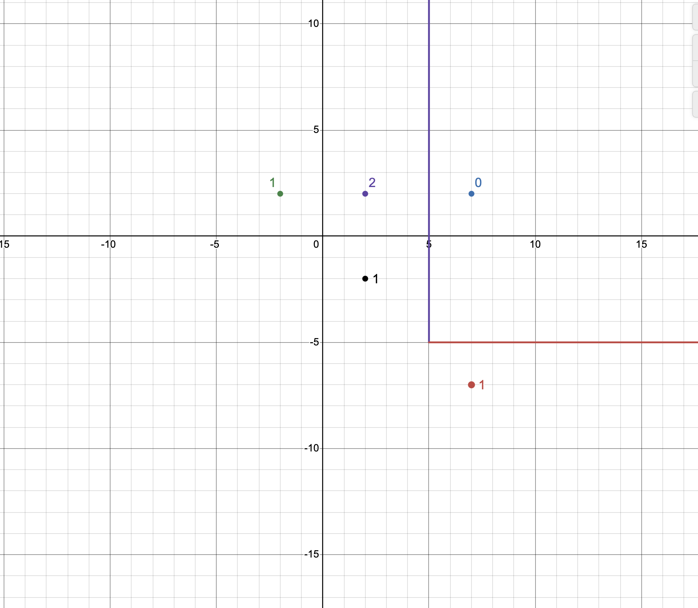

# Языки программирования

## Лабораторная работа 8

### Задание 1

*Рассмотрим программу на языке* **Python**.
```
x = [int(t) for t in input().split()]
for i in range(len(x)):
   if x[i] < i or x[i] > 2*i:
      break
print(i)
```
*Перепишите эту программу так, чтобы в ней использовался цикл* **while**, *в ней не использовалась
инструкция* **break**, *а используемый алгоритм не изменился. Полученная программа должна иметь следующий 
вид.*
```
x = [int(t) for t in input().split()]
i = 0
while ...:
   i += 1
print(i)
```
*Допишите правильное логическое выражение вместо многоточия. Выражение не должно содержать оператор* **not**.

**Решение**

Нужно найти первый индекс, для которого число выходит за пределы от `i` до `2*i` включительно.

```python
x = [int(t) for t in input().split()]
i = 0
while i + 1 < len(x) and i <= x[i] <= 2 * i:
    i += 1
print(i)
```


Пока число лежит в нужных пределах, переходим к следующему индексу. До последнего индекса доходим, но отдельно его не проверяем. Исходная программа в любом случае выводит этот индекс, если раньше ничего не нашла. Список должен быть непустым, как и в исходной программе.

### Задание 2

*Рассмотрим программу на языке* **Python**.
```
x = [int(t) for t in input().split()]
for i in range(len(x)):
   if i <= x[i] < 2*i or 3*i <= x[i] < 4*i:
      break
print(i)
```
*Перепишите эту программу так, чтобы в ней использовался цикл* **while**, *в ней не использовалась
инструкция* **break**, *а используемый алгоритм не изменился. Полученная программа должна иметь следующий 
вид.*
```
x = [int(t) for t in input().split()]
i = 0
while ...:
   i += 1
print(i)
```
*Допишите правильное логическое выражение вместо многоточия. Выражение не должно содержать оператор* **not**.

**Решение**

Нужно остановиться, когда число попадает хотя бы в один из двух промежутков.

```python
x = [int(t) for t in input().split()]
i = 0
while (i + 1 < len(x)
       and (x[i] < i or x[i] >= 2 * i)
       and (x[i] < 3 * i or x[i] >= 4 * i)):
    i += 1
print(i)
```


Цикл продолжается, пока число находится вне обоих промежутков. Для первого промежутка это значит, что число меньше `i` или не меньше `2*i`. Для второго проверка такая же, только границы `3*i` и `4*i`. Верхние границы в условии README не входят в промежутки. Последний индекс обрабатывается так же, как в первом задании.

### Задание 3

*Напишите пример программы на* **Java** *с двумя вложенными циклами и инструкцией* **break** *для выхода
из двух вложенных циклов. В качестве такой программы можно взять поиск первого нуля в двумерном массиве.*

**Решение**

Ищу первый ноль в двумерном массиве. Метка `search` стоит перед внешним циклом.

```java
class Main {
    public static void main(String[] args) {
        int[][] a = {{1, 2, 3}, {4, 0, 6}, {0, 8, 9}};

        search:
        for (int i = 0; i < a.length; i++) {
            for (int j = 0; j < a[i].length; j++) {
                if (a[i][j] == 0) {
                    System.out.println(i + " " + j);
                    break search;
                }
            }
        }
    }
}
```


Команда `break search` завершает оба цикла. Программа выводит `1 1`, потому что индексы начинаются с нуля.

### Задание 4

*Рассмотрим программу на языке* **Python**.
```
a = list(range(10))
b = [a.pop() - x for x in a]
print(*b)
```
*Объясните, почему список* **b** *получился именно таким.*

**Решение**

```python
a = list(range(10))
b = [a.pop() - x for x in a]
print(*b)
```

Цикл берёт элементы списка с начала, а `pop()` каждый раз удаляет элемент с конца. Список становится короче прямо во время обхода.

```text
9 - 0 = 9
8 - 1 = 7
7 - 2 = 5
6 - 3 = 3
5 - 4 = 1
```

В списке остаются числа от 0 до 4. Следующий индекс уже равен 5, поэтому обход заканчивается. Вывод программы — `9 7 5 3 1`.

### Задание 5

*Напишите программу на С++, которая прочитает натуральное число* **n**, *создаст вектор
из* **n** *элементов, прочитает значения элементов, добавит последний элемент вектора к каждому элементу 
(в том числе и к последнему), найдет и выведет количество положительных и отрицательных элементов вектора
после изменения. Из циклов в программе можно использовать только циклы по коллекции.*

**Решение**

Сначала считываю вектор. Затем сохраняю его последний элемент в отдельную переменную. К каждому элементу прибавляю это значение и сразу считаю положительные и отрицательные элементы.

```cpp
#include <iostream>
#include <vector>

int main() {
    int n;
    std::cin >> n;
    std::vector<int> a(n);

    for (int &x : a) {
        std::cin >> x;
    }

    int last = a.back();
    int positive = 0, negative = 0;
    for (int &x : a) {
        x += last;
        if (x > 0) {
            ++positive;
        } else if (x < 0) {
            ++negative;
        }
    }

    std::cout << positive << ' ' << negative << '\n';
}
```


В обоих циклах используется ссылка `int &x`, чтобы менять элементы самого вектора. Нули не считаю. Например, из `-3 -2 2` получится `-1 0 4`, поэтому ответ — `1 1`.

### Задание 6

*Представим, что в некотором будущем стандарте* **С++** *появится конструкция*
```
forc(i, from, to)
```
*которая будет раскрываться в следующий код.*
```
{
   int __i = from, __n=to;
   for(const int &i= __i; i < __n; __i++) {
      ...
   }
}
```
*Чем эта конструкция отличается от стандартного цикла* **for**? *Укажите два основных различия.
Напишите программы для демонстрации этих различий.*

*Написанные программы сохраните в папку с номером задания.*

**Решение**

Первое отличие — счётчик `i` внутри тела цикла доступен только для чтения. Сам цикл увеличивает переменную `counter`, на которую ссылается `i`. В обычном `for` счётчик можно менять и в теле цикла.

```cpp
#include <iostream>

int main() {
    for (int i = 0; i < 3; ++i) {
        ++i;
        std::cout << i << ' ';
    }
    std::cout << '\n';

    int counter = 0, end = 3;
    for (const int &i = counter; i < end; ++counter) {
        // ++i;  // Если убрать комментарий, программа не соберётся.
        std::cout << i << ' ';
    }
    std::cout << '\n';
}
```


Первый цикл выводит `1 3`, второй — `0 1 2`. Если раскомментировать `++i` во втором цикле, компилятор выдаст ошибку.

Второе отличие — верхняя граница `to` вычисляется один раз перед циклом. Обычный `for` с условием `i < to` проверяет текущее значение `to` на каждой итерации.

```cpp
#include <iostream>

int main() {
    int to = 4;
    for (int i = 0; i < to; ++i) {
        std::cout << i << ' ';
        to = 2;
    }
    std::cout << '\n';

    to = 4;
    int counter = 0, end = to;
    for (const int &i = counter; i < end; ++counter) {
        std::cout << i << ' ';
        to = 2;
    }
    std::cout << '\n';
}
```


Первый цикл выводит `0 1`, второй — `0 1 2 3`.

### Задание 7

*Напишите программу на языке* **Python** *для проверки того, что все числа во введенной 
последовательности неотрицательные. Если в цикле будет найдено отрицательное число, цикл должен
прерваться и вывести найденное число. Если отрицательных чисел нет, то вывести некоторое сообщение об этом.*

*Программа должна использовать конструкцию* **for break else**.

*Запишите аналогичную программу на С++. Какие изменения в алгоритме решения в ней появились?. Почему?*

*Написанные программы сохраните в папку с номером задания.*

**Решение**

Python. Ввожу числа через пробел. Если встречается отрицательное число, программа выводит его и прерывает цикл.

```python
numbers = [int(t) for t in input().split()]

for x in numbers:
    if x < 0:
        print(x)
        break
else:
    print("Отрицательных чисел нет")
```


Блок `else` выполняется, когда цикл дошёл до конца списка без `break`.

C++. Числа можно вводить через пробел или с новой строки. Если все числа неотрицательные, нужно закончить ввод. В консоли Windows для этого нажимаю Ctrl+Z и Enter.

```cpp
#include <iostream>

int main() {
    int x;
    bool found = false;

    while (std::cin >> x) {
        if (x < 0) {
            std::cout << x << '\n';
            found = true;
            break;
        }
    }

    if (!found) {
        std::cout << "Отрицательных чисел нет\n";
    }
}
```


В C++ у цикла нет блока `else`, поэтому использую переменную `found`. Она показывает, нашли ли отрицательное число. Если после цикла она осталась равна `false`, вывожу сообщение.

### Задание 8

*Рассмотрим следующую программу.* 
```
if x>=5 and y>=-5:
   print(0)
elif x<0 or y<0:
   print(1)
else:
   print(2)
```
*Нарисуйте на координатной плоскости множества значений при которых программа выводит 0, 1 и 2.*
*Фотографию рисунка вставьте в отчет*
*Опишите эти множества значений, используя язык теории множеств. Например,*

A = { (x,y)| x ∈ [5;∞), y ∈ [-5;∞)}.

**Решение**



- `A0 = {(x, y) | x >= 5 и y >= -5}`. Здесь сразу срабатывает первое условие.
- `A1 = {(x, y) | (x < 0 или y < 0) и (x < 5 или y < -5)}`. Здесь первое условие ложно, а второе истинно.
- `A2 = {(x, y) | 0 <= x < 5 и y >= 0}`. Здесь оба условия ложны.

Границы `x = 5` при `y >= -5` и `y = -5` при `x >= 5` входят в область 0. Границы `x = 0` при `y >= 0` и `y = 0` при `0 <= x < 5` входят в область 2.

### Задание 9

*Напишите программу на языке Python для решения следующей задачи.*

*Задана пронумерованная последовательность логических значений* **t(0), t(1), ..., t(n)**, **t(i) ∈ {False, True}**

*Последовательность обладает следующим свойством: существует некоторое число k такое, что 
все значения* **t(0), t(1), ..., t(k-1)** *равны* **False**, *а все значения* **t(k), ..., t(n)** *равны* **True**,
*то есть слева от* **k** *находятся значения* **False**, *а справа* - **True**. *Последовательность задается
функцией* **t(i)**, *которая возвращает логическое значение. Например, для тестирования эту функцию можно
задать следующим образом.*
```
def t(i):
   return i >= 1000
```

*Требуется написать программу, которая найдет число* **k**. *Программа должна реализовывать алгоритм 
бинарного поиска. Диапазон поиска задается переменными* **left** и **right**. *На каждом шаге вычисляется
центр диапазона, значение в нем проверяется, после чего диапазон сокращается в два раза.*

*Алгоритм должен быть записан через цикл* **while** *и реализовывать инвариант цикла*

t(left)=False ∧ t(right)=True

```
left = -1
right = 10**18
while ...:
   mid = ...
   if t(mid):
      ...
   else:
      ...
print(...)
```

**Решение**

Ищу первый индекс, на котором функция возвращает `True`. Слева ставлю условную границу `-1` со значением `False`. Функцию на этом индексе не вызываю. Справа беру границу, на которой значение уже `True`.

```python
def t(i):
    return i >= 1000


left = -1
right = 10**18

while right - left > 1:
    mid = (left + right) // 2
    if t(mid):
        right = mid
    else:
        left = mid

print(right)
```


На каждом шаге проверяю середину. Если там `True`, переношу туда правую границу. Если `False`, переношу левую. Так сохраняется инвариант из условия. Когда границы становятся соседними, `right` указывает на первое `True`. Для функции из примера программа выводит `1000`.
