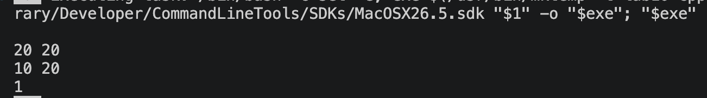
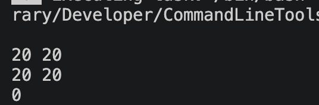
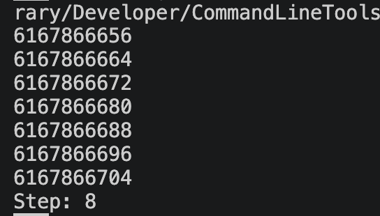
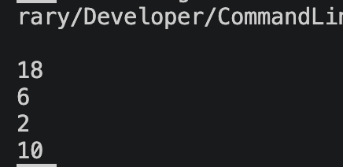
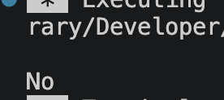
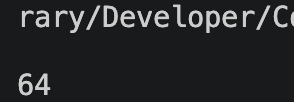
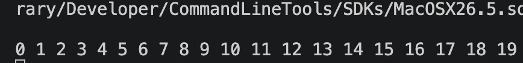
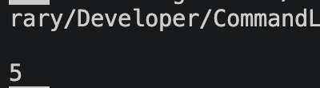
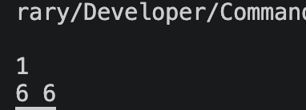
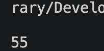

# Языки программирования
## Лабораторная работа 10

### Задание 1 **(2)**

*Рассмотрите следующие фрагменты программ. Запишите, что означают символы* **&** и  * *в каждом случае применения.*
```
int a = 10, b = 20;
int *p = &a , *q = &b;
p = q;
std::cout << *p <<' '<< *q << std::endl;
```
```
int a = 10, b = 20;
int *p = &a , *q = &b;
*p = *q;
std::cout << *p <<' '<< *q << std::endl;
```
*Чем различаются присваивания в третьей строке? Что можно вывести,
чтобы показать различия?*

*Примеры программ сохраните в папке с номером задания. Скриншоты работы прикрепите к отчету.*

**Решение**

В объявлении `int *p` звёздочка означает, что `p` — указатель на целое число. Знак `&` перед переменной получает её адрес. В выражении `*p` звёздочка даёт доступ к числу по этому адресу.

В первой программе `p = q` копирует адрес. Оба указателя начинают указывать на `b`. Переменная `a` остаётся равна 10.

```cpp
#include <iostream>

int main() {
    int a = 10, b = 20;
    int *p = &a, *q = &b;
    p = q;

    std::cout << *p << ' ' << *q << '\n';
    std::cout << a << ' ' << b << '\n';
    std::cout << (p == q) << '\n';
}
```

Вывод.

```text
20 20
10 20
1
```

Во второй программе `*p = *q` копирует само число. Значение `b` записывается в `a`. Указатели продолжают указывать на разные переменные.

```cpp
#include <iostream>

int main() {
    int a = 10, b = 20;
    int *p = &a, *q = &b;
    *p = *q;

    std::cout << *p << ' ' << *q << '\n';
    std::cout << a << ' ' << b << '\n';
    std::cout << (p == q) << '\n';
}
```

Вывод.

```text
20 20
20 20
0
```

Вывод `a`, `b` и результата `p == q` показывает различие. Единица означает, что адреса совпали, ноль — что они разные.





### Задание 2 **(1)**

*Рассмотрим следующую программу.* 
```
double x[10];
for (int i = 0; i <10; i++)
    std::cout << &x[i] << std::endl;
```
*Что она выводит? Измените
вывод так, чтобы адреса выводились в десятичной системе счисления.
Объясните почему числа составляют арифметическую прогрессию с
определенным шагом.*

*Записанную программу сохраните в папке с номером задания.*
*Скриншоты работы прикрепите к отчету.*

**Решение**

Исходная программа выводит адрес каждого элемента массива. Обычно адреса показываются в шестнадцатеричной записи. Чтобы получить десятичные числа, преобразую указатель в целочисленный тип `std::uintptr_t`.

```cpp
#include <iostream>
#include <cstdint>

int main() {
    double x[10];
    for (int i = 0; i < 10; i++) {
        std::cout << reinterpret_cast<std::uintptr_t>(&x[i]) << '\n';
    }
    std::cout << "Step: " << sizeof(double) << '\n';
}
```

Элементы массива лежат подряд. Поэтому каждый следующий адрес больше предыдущего на `sizeof(double)` байт. Обычно это 8 байт. Начальный адрес зависит от запуска программы.



### Задание 3 **(2)**

*Токен* **«*»** *в языке C++ может использоваться в трех различных
случаях. Аналогично токен* **«&»** *также может использоваться в трех
случаях. Приведите пример одной программы в которой они были бы
использованы во всех случаях.*

*Записанную программу сохраните в папке с номером задания.*

**Решение**

Звёздочка используется при объявлении указателя, при обращении к значению через указатель и при умножении. Знак `&` используется при получении адреса, при объявлении ссылки и как побитовое И.

```cpp
#include <iostream>

int main() {
    int x = 6, y = 3;
    int *p = &x;
    int &a = x;

    std::cout << x * y << '\n';
    std::cout << *p << '\n';
    std::cout << (x & y) << '\n';

    a = 10;
    std::cout << x << '\n';
}
```

В `int *p` объявляется указатель. В `&x` берётся адрес. В `int &a` объявляется ссылка на `x`. Выражение `x * y` умножает числа, `*p` читает число через указатель, а `x & y` выполняет побитовое И.

Вывод.

```text
18
6
2
10
```

Последнее число равно 10, потому что присваивание через ссылку `a` меняет переменную `x`.



### Задание 4 **(2)**

*Выпишите значения всех переменных, в том числе указателей,
после выполнения каждой инструкции программы. Объясните, что
происходит в результате выполнения каждой инструкции.*
```
unsigned a = 8, b = 3 ,c = 17;
unsigned *p = &a;
unsigned *q = &b;
*p += *q + c;
c = *q;
p = &c;
c += a;
*p += 10;
*q = *p;
q = p ;
*q += 10;
```

**Решение**

Адреса обозначаю как `&a`, `&b` и `&c`. Конкретные номера адресов зависят от запуска.

1. `unsigned a = 8, b = 3, c = 17;`
   Создаются три числа. Получается `a = 8, b = 3, c = 17`. Указатели ещё не объявлены.

2. `unsigned *p = &a;`
   Получается `a = 8, b = 3, c = 17, p = &a`. Указатель `q` ещё не объявлен.

3. `unsigned *q = &b;`
   Получается `a = 8, b = 3, c = 17, p = &a, q = &b`.

4. `*p += *q + c;`
   Меняется `a`, потому что на неё указывает `p`. Считаем `8 + 3 + 17 = 28`.
   Получается `a = 28, b = 3, c = 17, p = &a, q = &b`.

5. `c = *q;`
   В `c` записывается значение `b`.
   Получается `a = 28, b = 3, c = 3, p = &a, q = &b`.

6. `p = &c;`
   Указатель `p` теперь указывает на `c`.
   Получается `a = 28, b = 3, c = 3, p = &c, q = &b`.

7. `c += a;`
   Считаем `3 + 28 = 31`.
   Получается `a = 28, b = 3, c = 31, p = &c, q = &b`.

8. `*p += 10;`
   Через `p` меняется `c`.
   Получается `a = 28, b = 3, c = 41, p = &c, q = &b`.

9. `*q = *p;`
   Значение `c` записывается в `b`.
   Получается `a = 28, b = 41, c = 41, p = &c, q = &b`.

10. `q = p;`
    Оба указателя теперь указывают на `c`.
    Получается `a = 28, b = 41, c = 41, p = &c, q = &c`.

11. `*q += 10;`
    Меняется `c`.
    Получается `a = 28, b = 41, c = 51, p = &c, q = &c`.

### Задание 5 **(1)**

*Что сравнивается в приведенной ниже программе? Как можно
изменить первую строчку программы, чтобы результат тоже
изменился?*
```
int x = 1, y = 2;
int *p = &y, *q = &x;
if (p < q)
    std::cout << "Yes";
else
    std::cout << "No";
```

**Решение**

Сравниваются указатели `p` и `q`, то есть адреса переменных. Значения 1 и 2 напрямую на ответ не влияют. Если просто поменять числа в первой строке, это не задаст другой порядок адресов.

У разных отдельных переменных порядок размещения не гарантируется. Поэтому исходная программа может вывести `Yes` или `No`.

Для понятного результата можно заменить первую строку на массив и ссылки на его элементы.

```cpp
#include <iostream>

int main() {
    int a[2] = {1, 2}, &x = a[0], &y = a[1];
    int *p = &y, *q = &x;

    if (p < q)
        std::cout << "Yes";
    else
        std::cout << "No";
}
```

Здесь `p` указывает на второй элемент, а `q` — на первый. Поэтому выводится `No`.

Если в первой строке поменять ссылки местами,

```cpp
int a[2] = {1, 2}, &x = a[1], &y = a[0];
```

то `p` укажет на первый элемент, а `q` — на второй. Тогда получится `Yes`.



### Задание 6 **(2)**

*Объясните работу следующей программы. Как изменится
результат, если тип* **double** *изменить на некоторый другой, например*
**int** *или* **char**?
```
double x = 0;
double *d = &x;
std::cout << reinterpret_cast<size_t>(d + 4) - reinterpret_cast<size_t>(d - 4) << std::endl;
```

**Решение**

При сдвиге указателя на 4 адрес меняется на размер четырёх элементов. Между `d + 4` и `d - 4` получается расстояние в восемь элементов.

На обычной системе расчёт такой.

```text
double: 8 * 8 = 64 байта
int:    8 * 4 = 32 байта
char:   8 * 1 = 8 байт
```

Однако в исходной программе `x` — отдельная переменная. Вычислять такие указатели за её границами нельзя, поэтому стандарт C++ не гарантирует результат.

Чтобы выполнить этот опыт в пределах массива, можно взять девять элементов и поставить указатель в середину.

```cpp
#include <iostream>
#include <cstdint>

int main() {
    double x[9] = {};
    double *d = &x[4];
    std::cout << reinterpret_cast<std::uintptr_t>(d + 4)
                 - reinterpret_cast<std::uintptr_t>(d - 4) << '\n';
}
```

Теперь оба указателя указывают на элементы одного массива. При обычной записи адресов как номеров байтов получится 64. При замене типа нужно изменить его и у массива, и у указателя.



### Задание 7 **(2)**

*Объясните работу следующей программы. Как изменится
результат, если тип* **double** *изменить на некоторый другой, например*
**int** *или* **char**?
```
std::cout << reinterpret_cast <double*>(3000) - reinterpret_cast <double*>(2000) << std::endl;
```

**Решение**

Программа превращает числа 3000 и 2000 в указатели, затем вычитает их. При вычитании указателей результат считается в элементах.

На обычной системе можно ожидать такой расчёт.

```text
double: (3000 - 2000) / 8 = 125
int:    (3000 - 2000) / 4 = 250
char:   (3000 - 2000) / 1 = 1000
```

Это объясняет возможный вывод программы. Но вычитание указателей разрешено для элементов одного массива. По адресам 2000 и 3000 такой массив не создавался. Поэтому у исходного выражения неопределённое поведение и гарантированного результата нет.

### Задание 8 **(2)**

*Что надо дописать в записанной ниже программе вместо многоточий, чтобы
она выводила все числа из массива* **a**? *Почему?*
```
int a[20];
for ( int i = 0; i < 20; i++)
    a[i] = i;
int *b=a + 8;
for (int i =...; i <...; i++)
    std::cout << b[i] <<' ';
```

**Решение**

Указатель `b` указывает на элемент `a[8]`. Поэтому `b[i]` — это `a[8 + i]`.

Чтобы получить `a[0]`, нужен индекс `-8`. Чтобы получить `a[19]`, нужен индекс `11`. Значит, цикл идёт от -8 до 11 включительно.

```cpp
#include <iostream>

int main() {
    int a[20];
    for (int i = 0; i < 20; i++)
        a[i] = i;

    int *b = a + 8;
    for (int i = -8; i < 12; i++)
        std::cout << b[i] << ' ';
}
```

Программа выводит числа от 0 до 19. Отрицательный индекс здесь допустим, потому что после смещения мы остаёмся внутри массива `a`.



### Задание 9 **(2)**

*Что выводит следующая программа? Изменится ли результат если
изменить тип элементов массива?*

```
int a[10];
std::cout << &a[8] - &a[3] << std::endl;
```

**Решение**

Оба указателя относятся к одному массиву. Их разность равна разности индексов.

```text
8 - 3 = 5
```

```cpp
#include <iostream>

int main() {
    int a[10];
    std::cout << &a[8] - &a[3] << '\n';
}
```

Программа выведет 5. При замене типа элементов результат останется таким же, потому что разность указателей считается в элементах.



### Задание 10 **(1)**

*Есть ли разница между инициализацией* **p** и **q** *в следующей программе? Обоснуйте ответ.*
```
int x [10]={1, 2, 3, 4, 5, 6, 7, 8, 9, 10};
int *p = x + 5;
int *q = &x[5];
```

**Решение**

Оба способа дают адрес элемента с индексом 5.

`x + 5` сдвигает указатель на начало массива на пять элементов. Выражение `&x[5]` сразу берёт адрес того же элемента. Поэтому `p == q`, а `*p` и `*q` равны 6.

```cpp
#include <iostream>

int main() {
    int x[10] = {1, 2, 3, 4, 5, 6, 7, 8, 9, 10};
    int *p = x + 5;
    int *q = &x[5];
    std::cout << (p == q) << '\n';
    std::cout << *p << ' ' << *q << '\n';
}
```

Вывод.

```text
1
6 6
```



### Задание 11 **(3)**

*Указатели можно использовать для итерации по массивам.
Напишите программу, которая найдет сумму элементов массива,
используя указатели. В начале цикла указатель требуется установить
на начало массива, в конце каждой итерации смещать его к
следующему элементу массива через инкремент. Для выхода из цикла
надо проверять, что указатель дошел до конца массива.*
```
int x [10]={1, 2, 3, 4, 5, 6, 7, 8, 9, 10};
int s = 0;
for (int *p = ...; ...; ...)
    s += ...
std::cout << s;
```

*Записанную программу сохраните в папке с номером задания.*

**Решение**

Указатель начинает с первого элемента массива. После каждой итерации `p++` переносит его на следующий элемент. Через `*p` получаю значение и прибавляю к сумме.

```cpp
#include <iostream>

int main() {
    int x[10] = {1, 2, 3, 4, 5, 6, 7, 8, 9, 10};
    int s = 0;

    for (int *p = x; p != x + 10; p++)
        s += *p;

    std::cout << s << '\n';
}
```

Адрес `x + 10` находится сразу за последним элементом. Его можно использовать для проверки конца, но обращаться к значению по этому адресу нельзя. Цикл заканчивается до такого обращения. Сумма чисел от 1 до 10 равна 55.


